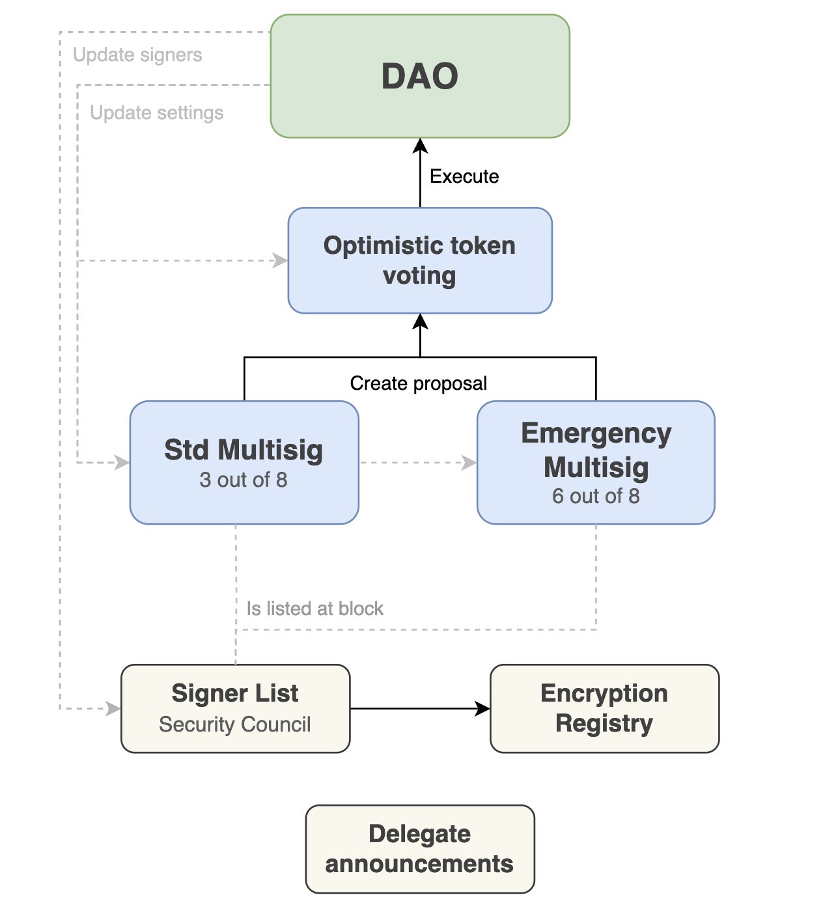
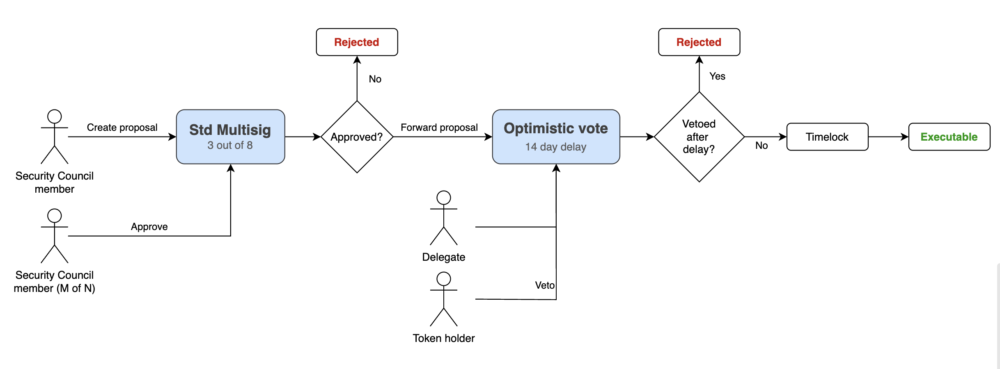
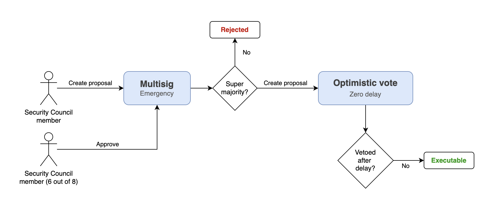

# Taiko DAO contracts

> [!NOTE]
> This repository is now read-only. You can find the most up to date version on https://github.com/taikoxyz/dao-contracts

This reposity contains the codebase of the Taiko DAO, along with its 3 plugins and helper contracts.

See the [audits folder](./audits) for the most up to date audit reports.

## Overview

The main goal of the present design is for the DAO to be flexible and future-proof by the use of modular plugins governing the DAO contract.

The DAO contract is an [Aragon DAO](https://github.com/aragon/osx), on which an **Optimistic Token Voting plugin** has the permission to execute the actions of a proposal.

Proposals on this plugin can only be created (forwarded) by two distinct multisig plugins, governed by Taiko's Security Council.



The Security Council operates a standard multisig plugin and an emergency variant.
- The **Standard Multisig** is designed to be the place where DAO proposals start their journey. Any signer can submit a new proposal to the Security Council. After a certain approval ratio is reached, the proposal will be forwarded to the Optimistic voting plugin, where the community will need to ratify it.
- The **Emergency Multisig**, is meant to only be used under exceptional circumstances, i.e. when a critical vulnerability needs to be addressed immediately. Any signer can submit proposals as well, but these proposals will need to be approved by a super majority before they can be executed directly on the DAO.

Both plugins source their list of signers from the same contract, named **SignerList**.

An important difference is that the Emergency Multisig is designed so that human readable descriptions and actions remain private to the signers, until the proposal is eventually executed.

[Learn more about Aragon OSx](#osx-protocol-overview).

See [Deploying the DAO](#deploying-the-dao) below and check out the [contract deployments](./DEPLOYMENTS.md).

## The DAO's plugins

### Optimistic Token Voting plugin

This plugin is an adapted version of Aragon's [Optimistic Token Voting plugin](https://github.com/aragon/optimistic-token-voting-plugin).

Only addresses that have been granted `PROPOSER_PERMISSION_ID` on the plugin can create proposals. These adresses belong to the two multisig's governed by the Security Council.

Proposals can only be executed when the veto threshold hasn't been reached after a given period of time.

The governance settings need to be defined when the plugin is installed but the DAO can update them at any time.

#### Permissions

- Only proposers can create proposals on the plugin
- The plugin can execute actions on the DAO
- The DAO can update the plugin settings
- The DAO can upgrade the plugin

### Standard Multisig

It allows Security Council members to create and approve proposals. After 3 approvals are registered, they are relayed to the [Optimistic Token Voting plugin](#optimistic-token-voting-plugin).

The list of signers for this plugin is sourced from the **SignerList** contract. Any changes on it will effect both multisig's.

The ability to relay proposals to the [Optimistic Token Voting plugin](#optimistic-token-voting-plugin) is restricted by a [permission condition](src/conditions/StandardProposalCondition.sol), which ensures that a minimum veto period is defined as part of the parameters.



#### Permissions

- Only listed signers can create proposals
- Only listed signers can approve
- The plugin can only create proposals on the [Optimistic Token Voting plugin](#optimistic-token-voting-plugin) provided that the `duration` is equal or greater than the minimum defined
- The DAO can update the plugin settings

### Emergency Multisig

Similarly, this plugin allows Security Council members to create and approve proposals. If 6 out of 8 signers approve them, proposals can be relayed to the [Optimistic Token Voting plugin](#optimistic-token-voting-plugin) with a delay period of 0 seconds, which allows for immediate execution.

Like before, the list of signers for this plugin is taken from SignerList contract.

There are two key differences with the standard Multisig:
1. The proposal's metadata and the actions to execute are encrypted, only Security Council members have the means to decrypt them. See [The encryption challenge](#the-encryption-challenge) below.
2. When the proposal is executed, its metadata and actions become publicly readable on the [Optimistic Token Voting plugin](#optimistic-token-voting-plugin). There is an integrity check to prevent any changes to the originally approved content.



#### Permissions

The Emergency Multisig settings are similar as the Standard Multisig's.

- Only listed signers can create proposals
- Only listed signers can approve
- The plugin can only create proposals on the [Optimistic Token Voting plugin](#optimistic-token-voting-plugin)
- The DAO can update the plugin settings

### Signer List

Both multisigs relate to this helper contract to determine if an address was listed at a certain block. It allows to read the state and manage the address list given that the appropriate permissions are granted (typically to the DAO).

It also plays an important role regarding encryption, this is why it is coupled with the [Encryption Registry](#encryption-registry) (see below).

It offers convenience methods to determine 3 potential states for a given address:
1. An address was a listed signer at a given past block (owner)
2. An address is appointed by another address, listed at a past block (appointed)
3. An address not listed or appointed

### The encryption challenge

It is common that Security Council agreements are reached with an organization, rather than with an individual. They typically act behind a smart wallet so that new members or leaving members do not impact the DAO.

However, smart wallets cannot possibly generate a private key, which means that encryption and decryption becomes unviable.

To this end, the [Encryption Registry](#encryption-registry) allows listed signers to **appoint** an EOA agent which acts on behalf of them. Such agent would typically be one of the organization's members and he or she can be replaced at any point.

With the Encryption Registry, the Security Council may onboard organizations behind a smart wallet while encryption remains operational for all of them.

Summary:
- Owners (listed signers)
  - Can always create emergency multisig proposals
  - Can also approve, only if they are not appointing another address
- Appointed EOA's (by a listed signer)
  - Can create emergency proposals
  - Can approve
  - Can execute (they can decrypt the actions and the metadata)

### Encryption Registry

This is a helper contract that allows Security Council members ([Signer List](#signer-list) addresses) to **register** their public key, which will be used to encrypt the proposal metadata and actions.

Given that smart contracts cannot possibly sign or decrypt data, the encryption registry allows to **appoint** an EOA as the agent for encryption purposes.

Refer to the [UI repository](https://github.com/aragon/taiko-ui?tab=readme-ov-file#encryption-steps) to read more about the encryption architecture.

### L2 Veto System

The DAO's governance token is bridged to Taiko L2, meaning a portion of voting power lives on L2. The L2 veto system allows L2 token holders to participate in the optimistic veto process without bridging back to L1.

Two contracts coordinate this:

- **L2VetoAggregator** (deployed on L2): L2 token holders call `veto(proposalId)` to cast their veto using their L2 voting power (snapshotted at proposal creation). Anyone can then call `dispatch(proposalId)` to bridge the aggregated tally to L1 via the Taiko Bridge.
- **L2VetoReceiver** (deployed on L1): Receives bridge messages from the trusted L2VetoAggregator, validates the proposalId against the plugin's proposal data, and pushes the L2 veto tally to the OptimisticTokenVotingPlugin.

The `proposalId` encodes timestamps (snapshot, start, end, counter) so the L2 contract can validate veto timing without querying L1.

The OptimisticTokenVotingPlugin has a `skipL2` governance setting that, when enabled, ignores L2 voting power entirely (both for token supply calculations and L2 veto acceptance). An `l2AggregationGracePeriod` setting adds extra time after `vetoEndDate` to allow L2 tallies to be bridged.

#### Permissions

- The DAO can set the trusted L2 aggregator address on the receiver (`SET_TRUSTED_L2_AGGREGATOR_PERMISSION_ID`)
- The DAO can set the L2VetoReceiver on the plugin (`UPDATE_L2_VETO_RECEIVER_PERMISSION_ID`)

### Delegation Wall

A simple helper contract that serves the purpose of storing the IPFS URI's pointing to the delegation profile posted by all candidates. Profiles can be updated by the owner and read by everyone.

## Installing plugins to the DAO

### Installing the initial set of plugins on the DAO

This is taken care by the [TaikoDAOFactory](src/factory/TaikoDaoFactory.sol) contract. It is invoked by [scripts/Deploy.s.sol](script/Deploy.s.sol). It creates a full, immutable and verifiable DAO deployment, given certain settings. The addresses of the deployed contracts can be read from it.

To create a DAO with different settings, a new factory needs to be deployed and invoked.

### Installing plugins on an existing DAO

Plugin changes need a proposal to be passed when the DAO already exists.

This involves two steps, a permissionless **preparation** and a privileged **application**.

1. Calling `pluginSetupProcessor.prepareInstallation()`
   - A new plugin instance is deployed with the desired settings
   - The call stores the request of a set of permissions
2. A proposal is passed to make the DAO call `applyInstallation()` on the [PluginSetupProcessor](https://devs.aragon.org/docs/osx/how-it-works/framework/plugin-management/plugin-setup/)
   - This applies the requested permissions and the new plugin can now interact with the DAO

These steps are made via a plugin setup. See [OptimisticTokenVotingPluginSetup](src/setup/OptimisticTokenVotingPluginSetup.sol) for an example.

[Learn more about plugin setup's](https://devs.aragon.org/docs/osx/how-it-works/framework/plugin-management/plugin-setup/) and [preparing installations](https://devs.aragon.org/docs/sdk/examples/client/prepare-installation).


## Get Started

To get started, ensure that [Foundry](https://getfoundry.sh/) and [Make](https://www.gnu.org/software/make/) are installed on your computer.

### Using the Makefile

The `Makefile` is the target launcher of the project. It's the recommended way to work with it. It manages the env variables of common tasks and executes only the steps that need to be run.

```
$ make
Available recipes:

  make init                 Prepare the project dependencies            [network="..."]
  make switch               Starts using the given network              [network="..."]
  make clean                Clean the compiler artifacts

Testing:

  make test                 Run all tests (local)
  make fork-test            Run all fork tests (exporting RPC_URL env)
  make test-coverage        Generate an HTML coverage report under ./report

Deployment:

  make predeploy            Simulate a plugin deployment
  make deploy               Deploy the plugin, verify the code and write to ./artifacts
  make resume               Continue a pending deployment, verify the code and write to ./artifacts

General:

  make anvil                Starts a forked EVM, using RPC_URL
  make refund               Transfer the balance left on the deployment account

Test tree management (bulloak):

  make sync-tests           Scaffold or sync tree files into solidity tests
  make check-tests          Check if solidity test files are out of sync
  make markdown-tests       Generate markdown file with test tree definitions
```

Run `make init network=<name>` (e.g. `hoodi`, `mainnet`, `taiko-hoodi`, `taiko-mainnet`):
- It selects the network configuration from the `networks/` folder
- It ensures that Foundry is installed
- It runs a first compilation of the project

Next, customize the values of `.env.example` for project-wide settings. Network-specific settings live under `networks/<name>/.env`.

### Understanding `.env.example`

The env.example file contains descriptions for all the initial settings. You don't need all of these right away but should review prior to fork tests and deployments

## Deployment

### Fresh DAO deployment

Initial deployments are done using [Deploy.s.sol](script/Deploy.s.sol), which deploys the [TaikoDaoFactory](./src/factory/TaikoDaoFactory.sol) and calls it. The factory will:

- Deploy the DAO and all three plugins (Multisig, EmergencyMultisig, OptimisticTokenVotingPlugin)
- Deploy helper contracts (SignerList, EncryptionRegistry)
- Set all permissions and then revoke its own ROOT access, making the DAO self-governing

The script also deploys the **L2VetoReceiver** on L1. After that, the L2 side needs to be deployed and wired:

1. **Deploy on L1**: `make deploy` (runs `Deploy.s.sol`)
2. **Deploy L2VetoAggregator on L2**: Run `DeployL2VetoAggregator.s.sol` against the L2 RPC
   - Requires: `L2_TAIKO_BRIDGE`, `L1_CHAIN_ID`, `L2_VOTING_TOKEN`, `L2_VETO_RECEIVER_ADDRESS`
3. **Generate the configuration proposal**: Run `ConfigureL2Veto.s.sol` to produce `proposals/proposal-configure-l2-veto.json`
   - Requires: `DAO_ADDRESS`, `PLUGIN_ADDRESS`, `L2_VETO_RECEIVER_ADDRESS`, `L2_VETO_AGGREGATOR_ADDRESS`
4. **Submit the proposal** to the DAO (grants permissions, sets receiver on plugin, sets trusted aggregator on receiver)

Check the available make targets to simulate and deploy:

```
make predeploy    Simulate a deployment
make deploy       Deploy, verify the code and write to ./artifacts
make resume       Continue a pending deployment
```

### Upgrading the OptimisticTokenVotingPlugin

For an existing DAO that needs the L2 veto system, the upgrade follows a multi-step process across two chains and two DAO proposals:

1. **Run `UpgradeOptimisticTokenVotingPlugin.s.sol` on L1**
   - Deploys a new L2VetoReceiver and an UpgradeFactory (which contains the new PluginSetup)
   - Outputs `proposals/proposal-1-upgrade.json` and `proposals/l1-deployments.json`
2. **Submit and execute DAO Proposal 1** (`proposal-1-upgrade.json`)
   - Grants temporary ROOT to the factory, publishes the new plugin version, runs the upgrade, and revokes ROOT
3. **Deploy L2VetoAggregator on L2**: Run `DeployL2VetoAggregator.s.sol` against the L2 RPC
   - Requires: `L2_TAIKO_BRIDGE`, `L1_CHAIN_ID`, `L2_VOTING_TOKEN`, `L2_VETO_RECEIVER_ADDRESS`
   - Outputs `proposals/l2-deployments.json`
4. **Run `FinalizeUpgrade.s.sol`** to generate `proposals/proposal-2-finalize.json`
   - Requires: `L2_VETO_RECEIVER_ADDRESS`, `L2_VETO_AGGREGATOR_ADDRESS`
5. **Submit and execute DAO Proposal 2** (`proposal-2-finalize.json`)
   - Sets the trusted L2 aggregator address on the receiver

### Deployment Checklist

- [ ] I have cloned the official repository on my computer and I have checked out the corresponding branch
- [ ] I am using the latest official docker engine, running a Debian Linux (stable) image
  - [ ] I have run `docker run --rm -it -v .:/deployment debian:bookworm-slim`
  - [ ] I have run `apt update && apt install -y make curl git vim neovim bc`
  - [ ] I have run `curl -L https://foundry.paradigm.xyz | bash`
  - [ ] I have run `source /root/.bashrc && foundryup`
  - [ ] I have run `cd /deployment`
  - [ ] I have run `make init network=<name>`
- [ ] I am opening an editor on the `/deployment` folder, within the Docker container
- [ ] The `.env` file contains the correct parameters for the deployment
  - [ ] I have created a brand new burner wallet with `cast wallet new` and copied the private key to `DEPLOYMENT_PRIVATE_KEY` within `.env`
  - [ ] I have reviewed the target network and RPC URL
  - [ ] I have checked that the JSON file under `MULTISIG_MEMBERS_JSON_FILE_NAME` contains the correct list of signers
  - [ ] I have ensured all multisig members have undergone a proper security review and are aware of the security implications of being on said multisig
  - [ ] I have checked that `MIN_STD_APPROVALS`, `MIN_EMERGENCY_APPROVALS` and `MULTISIG_PROPOSAL_EXPIRATION_PERIOD` are correct
  - [ ] I have verified that `L1_VOTING_TOKEN` corresponds to the intended ERC20 contract on the target chain
  - [ ] I have checked that `TAIKO_L1_ADDRESS` and `TAIKO_ERC20_VAULT_ADDRESS` belong to the target chain
  - [ ] I have checked that `L1_TAIKO_BRIDGE` and `L2_CHAIN_ID` are correct for the cross-chain setup
  - The plugin ENS subdomain
    - [ ] Contains a meaningful and unique value
  - The given OSx addresses:
    - [ ] Exist on the target network
    - [ ] Contain the latest stable official version of the OSx DAO implementation, the Plugin Setup Processor and the Plugin Repo Factory
    - [ ] I have verified the values on https://www.npmjs.com/package/@aragon/osx-commons-configs?activeTab=code > `/@aragon/osx-commons-configs/dist/deployments/json/`
- [ ] All the unit tests pass (`make test`)
- **Target test network**
  - [ ] I have switched to the testnet: `make switch network=<testnet-name>`
  - [ ] I have run a preview deployment: `make predeploy`
  - [ ] I have deployed my contracts successfully: `make deploy`
  - [ ] I have tested that these contracts work successfully
- **Target production network**
    - [ ] I have switched to the production network: `make switch network=<prodnet-name>`
    - [ ] I have verified that `L1_VOTING_TOKEN`, `TAIKO_L1_ADDRESS` and `TAIKO_ERC20_VAULT_ADDRESS` target the correct network
- [ ] My deployment wallet is a newly created account, ready for safe production deploys.
- My computer:
  - [ ] Is running in a safe physical location and a trusted network
  - [ ] It exposes no services or ports
  - [ ] The wifi or wired network used does not have open ports to a WAN
- [ ] I have previewed my deploy without any errors
  - `make predeploy`
- [ ] The deployment wallet has sufficient native token for gas
  - At least, 15% more than the estimated simulation
- [ ] Unit tests still run clean
- [ ] I have run `git status` and it reports no local changes
- [ ] The current local git branch (`main`) corresponds to its counterpart on `origin`
  - [ ] I confirm that the rest of members of the ceremony pulled the last commit of my branch and reported the same commit hash as my output for `git log -n 1`
- [ ] I have initiated the production deployment with `make deploy`

### Post deployment checklist

- [ ] The deployment process completed with no errors
- [ ] The deployed factory was deployed by the deployment address
- [ ] The reported contracts have been created by the newly deployed factory
- [ ] The L2VetoReceiver was deployed correctly
- [ ] The smart contracts are correctly verified on Etherscan or the corresponding block explorer
- [ ] The output of the latest `deployment-*.log` file corresponds to the console output
- [ ] I have transferred the remaining funds of the deployment wallet to the address that originally funded it
  - `make refund`

### Scripts reference

| Script | Chain | Purpose |
|--------|-------|---------|
| [Deploy.s.sol](script/Deploy.s.sol) | L1 | Full DAO deployment (factory + plugins + L2VetoReceiver) |
| [DeployL2VetoAggregator.s.sol](script/DeployL2VetoAggregator.s.sol) | L2 | Deploy L2VetoAggregator |
| [ConfigureL2Veto.s.sol](script/ConfigureL2Veto.s.sol) | L1 | Generate proposal to wire L2 veto into the plugin |
| [UpgradeOptimisticTokenVotingPlugin.s.sol](script/UpgradeOptimisticTokenVotingPlugin.s.sol) | L1 | Deploy upgrade factory + L2VetoReceiver, generate upgrade proposal |
| [FinalizeUpgrade.s.sol](script/FinalizeUpgrade.s.sol) | L1 | Generate proposal to set trusted L2 aggregator after upgrade |


## OSx protocol overview

OSx [DAO's](https://github.com/aragon/osx/blob/develop/packages/contracts/src/core/dao/DAO.sol) are designed to hold all the assets and rights by themselves. On the other hand, plugins are custom opt-in pieces of logic that can implement any type of governance. They are meant to eventually make the DAO execute a certain set of actions.

The whole ecosystem is governed by the DAO's permission database, which is used to restrict actions to only the role holding the appropriate permission.

### How permissions work

An Aragon DAO is a set of permissions that are used to define who can do what, and where.

A permission looks like:

- An address `who` holds `MY_PERMISSION_ID` on a target contract `where`

Brand new DAO's are deployed with a `ROOT_PERMISSION` assigned to its creator, but the DAO will typically deployed by the DAO factory, which will install all the requested plugins and drop the ROOT permission after the set up is done.

Managing permissions is made via two functions that are called on the DAO:

```solidity
function grant(address _where, address _who, bytes32 _permissionId);

function revoke(address _where, address _who, bytes32 _permissionId);
```

### Permission Conditions

For the cases where an unrestricted permission is not derisable, a [Permission Condition](https://devs.aragon.org/osx/how-it-works/core/permissions/conditions) can be used.

Conditional permissions look like this:

- An address `who` holds `MY_PERMISSION_ID` on a target contract `where`, only `when` the condition contract approves it

Conditional permissions are granted like this:

```solidity
function grantWithCondition(
  address _where,
  address _who,
  bytes32 _permissionId,
  IPermissionCondition _condition
);
```

See the condition contract boilerplate. It provides the plumbing to easily restrict what the different multisig plugins can propose on the OptimisticVotingPlugin.

[Learn more about OSx permissions](https://devs.aragon.org/osx/how-it-works/core/permissions/#permissions)

### Permissions being used

Below are all the permissions that a [PluginSetup](#plugin-setup-contracts) contract may want to request:

- `EXECUTE_PERMISSION` is required to make the DAO `execute` a set of actions
  - Only governance plugins should have this permission
- `ROOT_PERMISSION` is required to make the DAO `grant` or `revoke` permissions
  - The DAO needs to be ROOT on itself (it is by default)
  - Nobody else should be ROOT on the DAO
- `UPGRADE_PLUGIN_PERMISSION` is required for an address to be able to upgrade a plugin to a newer version published by the developer
  - Typically called by the DAO via proposal
  - Optionally granted to an additional address for convenience
- `PROPOSER_PERMISSION` is required to be able to create optimistic proposals on the governance plugin
- `UPDATE_MULTISIG_SETTINGS_PERMISSION_ID` is used by the DAO to update the settings of a multisig plugin, if the community approves
- `UPDATE_OPTIMISTIC_GOVERNANCE_SETTINGS_PERMISSION_ID` is used by the DAO to update the settings of the optimistic voting plugin, if the community approves
- `UPDATE_L2_VETO_RECEIVER_PERMISSION_ID` is used by the DAO to set the L2VetoReceiver address on the optimistic voting plugin
- `SET_TRUSTED_L2_AGGREGATOR_PERMISSION_ID` is used by the DAO to set the trusted L2VetoAggregator address on the L2VetoReceiver
- `UPDATE_SIGNER_LIST_PERMISSION_ID` is used to manage the list of signers on the SignerList contract
- `UPDATE_SIGNER_LIST_SETTINGS_PERMISSION_ID` is used by the DAO to update the SignerList settings (e.g. minimum signer count)

Other DAO specific permissions:

- `UPGRADE_DAO_PERMISSION`
- `SET_METADATA_PERMISSION`
- `SET_TRUSTED_FORWARDER_PERMISSION`
- `SET_SIGNATURE_VALIDATOR_PERMISSION`
- `REGISTER_STANDARD_CALLBACK_PERMISSION`

### Encoding and decoding actions

Making calls to the DAO is straightforward, however making execute arbitrary actions requires them to be encoded, stored on chain and be approved before they can be executed.

To this end, the DAO has a struct called `Action { to, value, data }`, which will make the DAO call the `to` address, with `value` ether and call the given calldata (if any). Such calldata is an ABI encoded array of bytes with the function to call and the parameters it needs.

### DO's and DONT's

- Never grant `ROOT_PERMISSION` unless you are just trying things out
- Never uninstall all plugins, as this would brick your DAO
- Ensure that there is at least always one plugin with `EXECUTE_PERMISSION` on the DAO
- Ensure that the DAO is ROOT on itself
- Use the `_gap[]` variable for upgradeable plugins, as a way to reserve storage slots for future plugin implementations
  - Decrement the `_gap` number for every new variable (slot) you add in the future

### Plugin upgradeability

By default, only the DAO can upgrade plugins to newer versions. This requires passing a proposal.

[Learn more about plugin upgrades](https://devs.aragon.org/docs/osx/how-to-guides/plugin-development/upgradeable-plugin/updating-versions)

## Testing

See the [test tree](./TEST_TREE.md) file for a visual representation of the implemented tests.

Tests can be described using yaml files. They will be automatically transformed into solidity test files with [bulloak](https://github.com/alexfertel/bulloak).

Create a file with `.t.yaml` extension within the `test` folder and describe a hierarchy of test cases:

```yaml
# MyTest.t.yaml

MultisigTest:
- given: proposal exists
  comment: Comment here
  and:
  - given: proposal is in the last stage
    and:

    - when: proposal can advance
      then:
      - it: Should return true

    - when: proposal cannot advance
      then:
      - it: Should return false

  - when: proposal is not in the last stage
    then:
    - it: should do A
      comment: This is an important remark
    - it: should do B
    - it: should do C

- when: proposal doesn't exist
  comment: Testing edge cases here
  then:
  - it: should revert
```

Then use `make` to automatically sync the described branches into solidity test files.

```sh
$ make
Available targets:
# ...
- make sync-tests       Scaffold or sync tree files into solidity tests
- make check-tests      Checks if solidity files are out of sync
- make markdown-tests   Generates a markdown file with the test definitions rendered as a tree

$ make sync-tests
```

The final output will look like a human readable tree:

```
# MyTest.tree

EmergencyMultisigTest
├── Given proposal exists // Comment here
│   ├── Given proposal is in the last stage
│   │   ├── When proposal can advance
│   │   │   └── It Should return true
│   │   └── When proposal cannot advance
│   │       └── It Should return false
│   └── When proposal is not in the last stage
│       ├── It should do A // Careful here
│       ├── It should do B
│       └── It should do C
└── When proposal doesn't exist // Testing edge cases here
    └── It should revert
```
